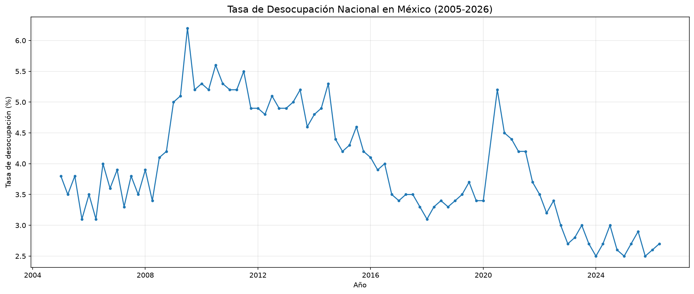
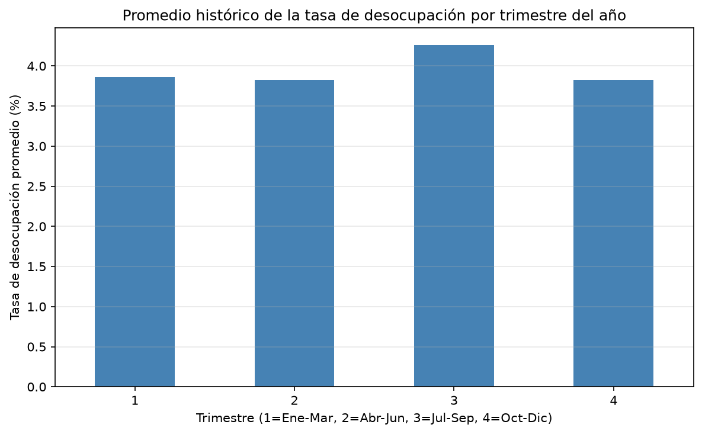
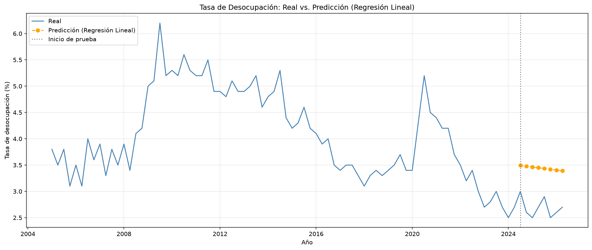
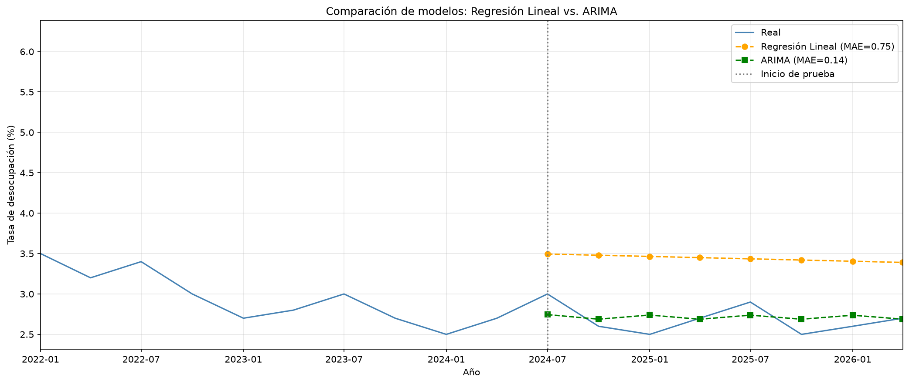

# Sistema predictivo de la tasa de desocupación en México

Análisis y exploración de datos históricos de la ENOE (INEGI), de 2005-1T a 2026-2T (85 trimestres), con comparación de dos modelos predictivos: regresión lineal y ARIMA.

## Fuente de datos

INEGI, Encuesta Nacional de Ocupación y Empleo (ENOE), población de 15 años y más: "Consulta Interactiva de indicadores estratégicos (Infolaboral), Nueva versión".

- Indicador: 10.2 Unemployment rate
- Filtros: Geographic area = National, Datatype = Percentages, Gender = Total
- Archivo usado: `Interactivos20260924194310.csv`

https://www.inegi.org.mx/programas/enoe/15ymas/

## Preparación de los datos

- Lectura del CSV (codificación latin-1).
- Filtrado de la tasa nacional total (`Gender == 'Total'`).
- Construcción de una columna de fecha a partir del año y el trimestre.
- Ordenamiento cronológico (85 observaciones).

## Análisis exploratorio

Promedio histórico de 3.94% (mínimo 2.5%, máximo 6.2%). El pico máximo ocurre en el tercer trimestre de 2009 (crisis financiera global) y el mínimo histórico en el primer trimestre de 2024.

El tercer trimestre (julio-septiembre) tiende a ser el más alto del año.

## Modelos predictivos

Los modelos se evaluaron sobre los últimos 8 trimestres de la serie.

| Modelo | MAE | RMSE |
|---|---|---|
| Regresión lineal | 0.755 | 0.772 |
| ARIMA(2,1,2) | 0.137 | 0.162 |

ARIMA(2,1,2) reduce el error de forma considerable frente a la regresión lineal.